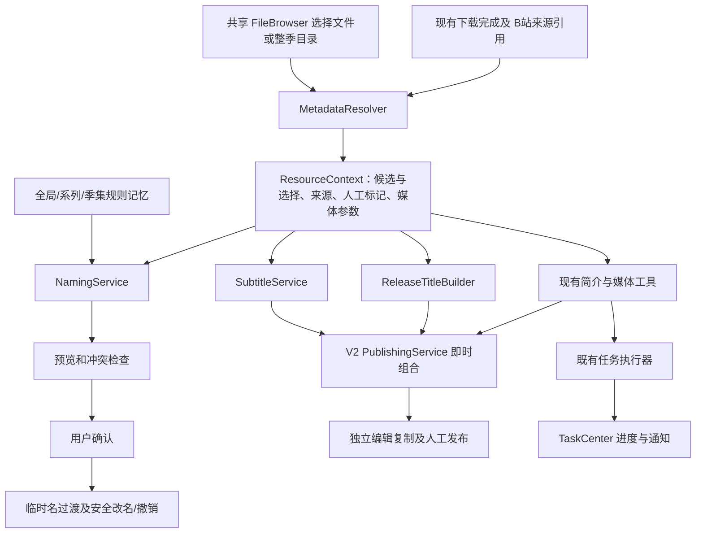

# Bili Remote 2.0 架构方案

状态：依据用户于 2026-11-03 补充的正式需求制定，供架构审阅。本次只提交环境、契约和任务，不实现以下新服务或接口，也不执行迁移。

## 产品边界

Bili Remote 2.0 是以真实文件为入口、以识别和标准命名为基础、服务于人工 PT 发布的轻量工作台。一次识别、所有模块复用；自动生成、人工可改；预览后确认执行。只记住规则，不保存发布内容，不创建资源项目。侧边栏固定为首页、文件管理、发种工作台、B站下载、设置。缩略图、媒体报告、图床、种子和 qBittorrent 均归工作台内部工具。

发种工作台为左侧共享 FileBrowser、右侧发布内容/缩略图/媒体报告/种子制作四视图；资源识别与命名区域始终可访问。主标题、副标题、简介分别编辑复制，完整内容随修改即时更新。刷新可恢复后台任务状态；不恢复主标题、副标题、简介或完整内容草稿。

## 当前项目审计

现有系统为 Python/FastAPI + SQLite + Jinja2 模板 + 原生 JavaScript/CSS；没有 Node 构建依赖。`web.py:create_app` 集中注册路由，`services.py:Services.build` 负责装配和生命周期，`database.py:Database.initialize` 管理迁移。配置由环境默认值和加密/白名单的 SQLite settings 合成。

| 现有组件 | 已有能力 | 2.0 处理 |
| --- | --- | --- |
| downloader.py、bili.py | Web/TV 登录、解析、分P/合集、选集、aria2、队列、重试和历史 | 保留引擎与接口，优先改 WebUI，增加窄联动适配器 |
| file_service.py、filebrowser.py | 四类浏览根、八挂载配置、分页搜索、编辑、复制移动删除、改名预览 | 复用现有安全能力，不建立第二套文件系统 |
| naming.py | 旧项目命名、预览、改名记录及回滚；关联 release_projects | 新服务与项目解耦；复用可独立的校验算法，不能复用项目生命周期 |
| metadata.py | TMDB 中英文、PT-Gen 搜索/详情及资料保存接口 | 新 Resolver 复用只读适配器，补名称候选、演员、季集和 Bangumi；不调用旧保存接口 |
| media_probe.py | ffprobe、技术参数归一化 | 同一探测入口扩展，不让前端推断参数；旧 H265 输出通过 V2 标签适配输出 H265 |
| publishing.py:PublishService | 主标题/副标题混合及发布会话持久化 | V2 拆分三种职责，新组合服务无草稿存储依赖 |
| screenshots/collage/release_info/torrents/image_hosts/qbittorrent | 截图、拼图、媒体报告、图床、制种和添加下载器 | 保留实际文件结果和任务引用，不以发布草稿串联 |
| processing.py、tool_jobs.py、jobs | 两类现有持久化执行队列 | TaskCenter 统一视图与通知，不创建第三个队列 |

生产代码声明 Python >=3.12，Dockerfile 为 Python 3.12；宿主机既有测试 venv 是 3.11.2。现有 210 项测试在隔离副本全部通过，不等同于已完成 Python 3.12 验证。完整基线见 acceptance.md。

## 最终模块分层

| 模块 | 唯一职责 | 明确不承担 |
| --- | --- | --- |
| MetadataResolver | 聚合 B站、TMDB、Bangumi、可选 PT-Gen；返回候选身份、名称、演职员和来源信息 | 文件写入、生成发布文案、保存草稿 |
| NamingService | 身份选择应用、名称/季集/媒体参数、映射、命名规则、预览、安全改名、关联文件和撤销 | PT 副标题、发布主标题或完整发布内容 |
| SubtitleService | 四种 PT 副标题与可配置字段/排序/分隔符，人工调整 | 文件名、主标题、简介、MediaInfo、BBCode/HTML |
| ReleaseTitleBuilder | 使用结构化媒体参数和独立 PT 主标题规则生成主标题 | 简单把文件名用于所有站点、写草稿 |
| PublishingService（V2） | 组合独立主/副标题、现有简介、海报、报告、截图、链接为 BBCode/HTML/Markdown | 生成副标题算法、项目/会话/草稿持久化、向 PT 站提交 |
| FileBrowser | 共用安全文件读写、路径约束、文件操作和选择器 | 第二套识别、命名算法或物理目录布局 |
| DownloadService | 保留下载能力，完成后提供结构化来源引用 | 第二套命名/副标题或任务中心 |
| TaskCenter | 聚合既有 jobs/processing_tasks，任务状态、进度、日志、取消、重试、完成通知 | 发布内容存储、发种项目流程 |

实现路径与独占文件见 file-ownership.md。Naming 与 Resolver 由 naming 会话负责；ReleaseTitleBuilder 与 V2 PublishingService 由 workbench 会话负责，仍是独立文件/接口。公共模型、TaskCenter 装配和数据库迁移由整合会话负责。

## 统一数据流

前端仅持有同一个 ResourceContext 与 revision。对身份、季集或人工字段的改变使后续预览失效；跨模块传递结构化对象，禁止前端拼文件名、副标题。识别结果在当前页面内复用；服务端可短时内存缓存探测和候选，键包含路径指纹、provider 和选择修订，不长期保存生成文案。

## 命名和数据可信性

正式模板、字段和默认值见 data-model.md。Source 默认 WEB-DL、Group 默认 HDVWEB、Season 默认 1 都是规则值，必须标注 default/memory/manual，不能标为探测事实。视频参数逐文件来自真实 ffprobe/MediaInfo；不能由分辨率推导片源、由 H264 推导 x264。未知值为空、可手动补充，缺项与默认项在预览中明确显示。

自动集数证据优先 B站结构化信息 > TMDB 季集 > 文件名解析 > 未解决时提示人工指定；已明确选择的人工修正为锁定覆盖值，不被后续低优先级结果冲掉。映射键至少含 season_id/ep_id/cid 和 TMDB 系列/季/集。整季集数来自选中季的真实剧集列表；不是全剧 episode_count。动漫展示 TMDB/Bangumi 多语言候选和声优，不固定选择首个英文名。

所有改名原地执行，默认仅预览。高置信度自动改名默认关闭，只有设置明确开启、身份及映射均确认、指纹未变且无冲突时才可执行相同安全管线；不能绕过关联关系校验。字幕保留 chs/cht/eng 等语言后缀，外置音轨须明确关联。临时名过渡、逐项日志、失败恢复和撤销以最小文件操作审计实现，不创建项目。

## 持久化白名单

允许 settings、Naming Memory（含副标题规则）、下载来源关联、后台任务状态与必要执行输入/结果、实际生成的截图/报告/种子/上传结果、最小改名撤销记录。生成的文件名只可作为已执行文件操作审计中的目标路径，不能作为规则记忆或命名历史库。

禁止新工作台写入发布草稿、发布会话、资源项目、主/副标题生成历史、完整 BBCode 或简介草稿；不得以 localStorage、任务 input/result、缓存表或 telemetry 变相保存。原始抓取资料不整体落库。命名记忆只保存选定名称/别名、身份及规则，不保存演员介绍或生成文本。任务刷新恢复只恢复执行进度和真实产物引用，页面需重新识别并即时生成内容。

## 差异与渐进迁移

| 现有冲突 | 迁移方案 | 本次动作 |
| --- | --- | --- |
| publish_sessions、旧保存/恢复草稿 UI | 新工作台完全不调用；保留旧路由和表兼容，不增加导航入口 | 仅记录，未删除或迁移 |
| release_projects/release_files 与改名记录强绑定 | V2 使用 ResourceRef；新增无项目依赖的最小改名记录，旧项目记录不搬迁 | 只设计新模型 |
| media_metadata、release_documents 可保存资料 | 新流程不调用 metadata.save 或 create 草稿；媒体报告仅保存实际工具产物/执行引用 | 由整合会话后续写入白名单隔离 |
| PublishService 同时拼主/副标题 | 新增独立 builder/service，组合层只组合返回值；旧服务保留原契约 | 新任务明确边界 |
| TMDB 名称不足、缺 Bangumi 演职员和季集映射 | 统一 resolver provider，来源可追溯、候选人工选择、超时可降级 | 后续实现并验收 |
| 旧模板小写字段、:02d、H265 | V2 显式转换层，旧接口仍接受原格式并返回原语义 | 不修改旧模板库 |
| 两套既有任务数据 | 只增加统一 TaskRef 投影，带 kind 避免 ID 冲突 | 不重建执行队列 |

顺序：审阅本方案 → 公共契约/存储接口由整合会话落实 → 五模块按独占文件并行实现/使用测试替身 → 整合会话注册路由、模板和迁移 → 兼容/安全/浏览器验收 → 独立授权的部署。本阶段到工作区与文档准备为止。

## 外部服务核验边界

现有 `metadata.py` 证明适配器支持 TMDB v3 搜索/详情，以及两种 PT-Gen 搜索路径和 `apikey` 查询参数，但这只是本地实现证据。实际服务版本、权限、字段及 Bangumi 能力尚未进行新的在线认证核验；不能把容器运行或 mock 通过写为实测通过。后续 naming 任务须用开发凭据验证真实只读接口，保存脱敏结构样本和能力报告，失败不阻塞离线命名与人工输入。不得取用生产密钥或 Cookie。
